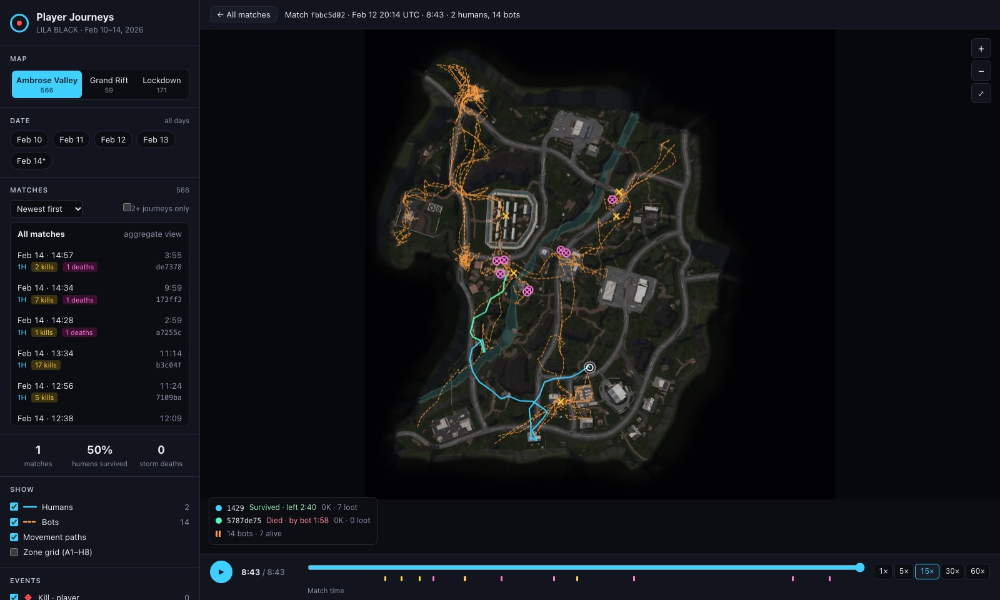
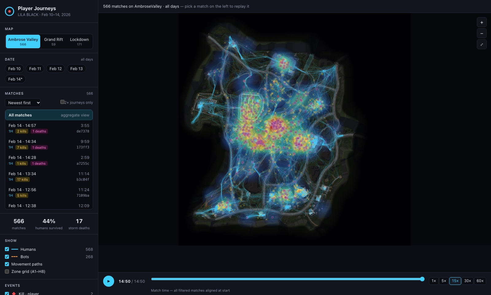

# LILA BLACK · Player Journey Visualizer

A browser tool for Level Designers to explore how players move, fight, loot and die on LILA BLACK's maps. It uses 5 days of production telemetry (Feb 10–14, 2026).

**Live:** https://lila-player-journeys.netlify.app

- [ARCHITECTURE.md](ARCHITECTURE.md): stack, data flow, coordinate mapping, assumptions, trade-offs
- [INSIGHTS.md](INSIGHTS.md): three findings made with the tool
- [WALKTHROUGH.md](WALKTHROUGH.md): a 5-minute feature tour





## What it does

| Feature | How |
|---|---|
| Player journeys on the right minimap | World `(x, z)` → minimap via each map's scale/origin. Pan with drag, zoom with the wheel or a double-click. |
| Humans vs bots | Humans are **solid cyan** (one colour per human in match view). Bots are **dashed orange**. Each can be toggled. |
| Event markers | A distinct **shape and colour** for each: player kill ⊕, bot kill ✕, death by player ⊗ red, death by bot ⊗ pink, storm death ◆, loot ■. Hover any marker for who, when and which match. |
| Filters | Map, date (multi-select), single match. Sort by newest, most combat, longest or most journeys. "2+ journeys only" option. |
| Timeline / playback | Play, pause and scrub at 1×–60×. Kill and death ticks on the track are clickable. Moving heads show positions, a white ring marks a survivor's last position, and a roster shows each player's status live. |
| Heatmaps | Traffic, Kills, Deaths, Storm and Loot. They follow every filter and the timeline. |
| Aggregate view | With no match selected, all filtered matches are overlaid and aligned at t=0. Scrub to see *when* things happen across many matches. |
| Zone grid | An A1–H8 overlay so areas can be named in discussion. |
| Shareable state | Map, match, dates and heatmap are kept in the URL hash. |

Keyboard: `Space` plays/pauses, `←`/`→` seeks ±5 s, `Esc` goes back to all matches.

## Tech stack

- **Pipeline:** Python 3.10+, pyarrow, pandas, Pillow (`pipeline/`)
- **App:** React 18, TypeScript, Vite 5, Canvas 2D. No runtime dependencies beyond React.
- **Hosting:** static files (Netlify config included; Vercel and other static hosts work as-is)

## Setup

```bash
npm install
npm run dev            # http://localhost:5173
npm run build          # -> dist/
```

The processed data (`public/data/*.json`, `public/minimaps/*.webp`) is committed, so the app runs without Python.

### Regenerate the data from the raw parquet files

```bash
python3 -m venv .venv
.venv/bin/pip install -r pipeline/requirements.txt
.venv/bin/python pipeline/build_data.py --src /path/to/player_data --out public
.venv/bin/python pipeline/insights.py            # reproduces INSIGHTS.md numbers
```

`--src` should point at the unzipped `player_data/` folder, which contains the `February_*` folders and `minimaps/`. `npm run data` assumes it sits next to this repo.

### Tests

```bash
npm test
```

This runs 10 checks:
- **The coordinate mapping:** the README's sample point lands at pixel (78, 890), and the world origin lands at the bottom-left corner.
- **Pipeline cleanup:** `ts` is read as Unix seconds, the event bytes are decoded, and duplicate rows are dropped.
- **Bot detection by telemetry:** a numeric ID that sends `Position` data counts as a human and gets flagged.
- **How a drawn path is put together:** movement samples and event spots are merged in time order.

It needs Node 22.6+ and the Python venv described above.

### Environment variables

None. The app is fully static.

### Deploy

- **Netlify:** connect the repo. `netlify.toml` already sets `npm run build` → `dist`.
- **Vercel:** import the repo. Vite is auto-detected (build `npm run build`, output `dist`).

## Project layout

```
pipeline/
  build_data.py      parquet -> cleaned, mapped, compact JSON + resized minimaps
  insights.py        stats behind INSIGHTS.md
  test_build_data.py pipeline tests (mapping, timestamps, duplicates, bot detection)
public/
  data/              generated JSON (index + one file per map)
  minimaps/          generated 2048² webp minimaps
src/
  App.tsx            state, filtering, playback loop, URL hash
  data.ts            types, event styles, loaders, path/event merge
  data.test.ts       tests for the path/event merge
  render.ts          canvas drawing: paths, markers, heads, grid
  heatmap.ts         density grid + blur + colour ramp
  components/        MapView (pan/zoom/hover), Sidebar, Timeline, Roster, MarkerIcon
```
